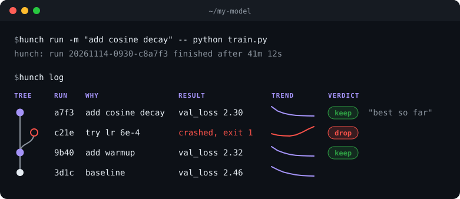

<div align="center">
  <br/>
  

# Hunch

**Every hunch, tracked.**

<a href="https://github.com/sigmoid-ide/hunch/actions/workflows/ci.yml"></a>
<a href="https://pypi.org/project/sigmoid-hunch/"></a>


<a href="https://github.com/sigmoid-ide/hunch/blob/main/LICENSE"></a>

</div>

<p align="center">
  
</p>

Every run keeps its code, config, environment, metrics and **why**, and knows which run it came from.

```bash
pip install sigmoid-hunch
```

## If you know git, you know Hunch

| git | hunch |
|---|---|
| `git commit -m "why"` | `hunch run -m "why" -- python train.py` |
| `git log` | `hunch log` |
| `git log --oneline` | `hunch log --oneline` |
| `git show a7f3` | `hunch show a7f3` |
| `git diff 9b40 a7f3` | `hunch diff 9b40 a7f3` |
| `git notes add` | `hunch note a7f3 "helps" --keep` |
| `git tag -a v1 -m "..."` | `hunch milestone "warmup beats baseline"` |
| `git config` | `hunch config main-metric val_loss` |

**How is it different from git?** Git tracks what you changed. Hunch tracks what you tried, and what happened.
Run the same code 20 times with different learning rates: git sees one commit, Hunch sees 20 experiments with their results.

## In your code

```python
import hunch

hunch.init(config=args, why="warmup to fix loss spikes")
hunch.log({"val_loss": val_loss}, step=step)
```

Same names as W&B: `import hunch as wandb` works.

## Your disk, your files

No server, no account, no telemetry, no dependencies, and git is optional. Runs are plain files in `.hunch/`.

[Guide](https://github.com/sigmoid-ide/hunch/blob/main/docs/guide.md) · [File format](https://github.com/sigmoid-ide/hunch/blob/main/docs/format.md) · [Questions](https://github.com/sigmoid-ide/hunch/discussions/categories/q-a) · [Contributing](https://github.com/sigmoid-ide/hunch/blob/main/CONTRIBUTING.md)

## Share it

Saved you a "what did I run last month?" moment? Tell one person, or post your `hunch log` in
[Show and tell](https://github.com/sigmoid-ide/hunch/discussions/categories/show-and-tell).

<p align="center">
  <a href="https://x.com/intent/post?text=Hunch%3A%20every%20hunch%2C%20tracked.%20Every%20ML%20run%20keeps%20its%20code%2C%20config%2C%20environment%20and%20why.%20pip%20install%20sigmoid-hunch&url=https%3A%2F%2Fgithub.com%2Fsigmoid-ide%2Fhunch"></a>
  <a href="https://www.reddit.com/submit?url=https%3A%2F%2Fgithub.com%2Fsigmoid-ide%2Fhunch&title=Hunch%3A%20every%20hunch%2C%20tracked.%20An%20experiment%20journal%20for%20ML"></a>
  <a href="https://news.ycombinator.com/submitlink?u=https%3A%2F%2Fgithub.com%2Fsigmoid-ide%2Fhunch&t=Hunch%3A%20every%20hunch%2C%20tracked.%20An%20experiment%20journal%20for%20ML"></a>
  <a href="https://www.linkedin.com/sharing/share-offsite/?url=https%3A%2F%2Fgithub.com%2Fsigmoid-ide%2Fhunch"></a>
</p>

Tracking a research repo with Hunch? Show it:
[](https://github.com/sigmoid-ide/hunch)

```markdown
[](https://github.com/sigmoid-ide/hunch)
```

## Team

<table align="center">
  <tr>
    <td align="center">
      <a href="https://github.com/rainxchzed">
        <picture>
          <source media="(prefers-color-scheme: dark)" srcset="https://wsrv.nl/?url=github.com%2Frainxchzed.png%3Fsize%3D400&precrop=true&cx=32&cy=32&cw=336&ch=336&w=220&h=220&fit=cover&mask=circle&mbg=0d1117&maxage=7d" />
          
        </picture>
      </a>
      <br />
      <a href="https://github.com/rainxchzed"><b>rainxchzed</b></a>
      <br />
      
    </td>
  </tr>
</table>

<p align="center">Apache-2.0 · Part of Sigmoid IDE · Like it? Give it a star.</p>
